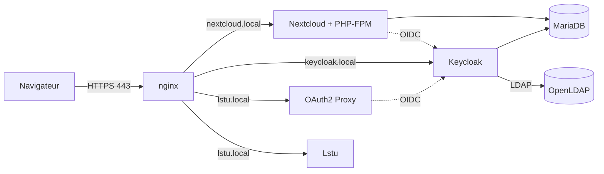

# Administrer un serveur web

><i> Rémi CROCHET et Ronan FISSON </i>

Ce projet est notre réalisation de la SAÉ *Administrer un serveur web* : une infrastructure web complète où **un seul compte d'annuaire donne accès à plusieurs applications**, avec une authentification centralisée.

- **Nextcloud** (stockage et partage de fichiers) : on s'y connecte avec Keycloak.
- **Lstu** (raccourcisseur d'URL) : la création de liens est réservée aux utilisateurs connectés, mais **visiter un lien raccourci reste public**.
- **Keycloak** centralise l'authentification et s'appuie sur **OpenLDAP** pour connaître les utilisateurs.
- **OAuth2 Proxy** protège les pages d'administration de Lstu, qui n'a pas de gestion d'utilisateurs adaptée.

Tout se lance avec une seule commande et se reconstruit à l'identique.

## Vue d'ensemble



Quand un utilisateur ouvre Nextcloud ou une page protégée de Lstu, il est redirigé vers Keycloak. Keycloak vérifie son identifiant et son mot de passe dans l'annuaire OpenLDAP, puis renvoie l'utilisateur vers l'application, authentifié.

## Les briques

| Brique | Rôle | Installation |
|---|---|---|
| nginx | Serveur web, HTTPS, point d'entrée unique | Paquet Debian |
| OpenLDAP | Annuaire des utilisateurs | Paquet Debian |
| MariaDB | Bases de Nextcloud et de Keycloak | Paquet Debian |
| PHP-FPM | Exécution de Nextcloud | Paquet Debian |
| Nextcloud | Cloud personnel | Archive officielle |
| Keycloak | Fournisseur d'identité (OIDC) | Archive officielle |
| Lstu | Raccourcisseur d'URL | Dépôt officiel (framagit) |
| OAuth2 Proxy | Protection des pages de Lstu | Release officielle |

Conformément au sujet, seules les briques disponibles dans Debian sont installées par paquets. Les autres le sont depuis les sources officielles, **sans utiliser leurs images Docker**.

## Choix de nos outils

Nous avons opté pour une structure mêlant **Docker** et **Ansible**. Le but était de fournir l'équivalent d'une machine Linux tout en gardant une configuration facilement exportable et reproductible.

- **Docker joue le rôle de machine virtuelle** : une image Debian 12 avec `systemd`. Cet usage est volontairement non conventionnel (conteneur privilégié, un seul conteneur pour tous les services), c'est ce qui nous permet d'installer les logiciels comme sur un vrai serveur.
- **Ansible décrit l'installation** : une infrastructure *as code*, versionnée avec le projet. Nous pouvons ainsi travailler en dehors de l'IUT sans dépendre des machines de la salle. C'était la première fois que nous utilisions Ansible.
- **nginx** est le serveur web retenu, un choix arbitraire.

Chaque service correspond à un playbook et à une couche Docker (`ansible/01-ldap.yml` à `ansible/08-provision.yml`) : modifier un service ne reconstruit pas les autres.

## Démarrage rapide

Prérequis : Linux, Docker avec Docker Compose, `git`, `openssl`, les ports 80 et 443 libres.

```bash
git clone <URL-DU-DEPOT> crochet-fisson-admin-web
cd crochet-fisson-admin-web

bash ansible/certs/gen-certs.sh        # autorité de certification + certificat
echo "127.0.0.1 nextcloud.local keycloak.local lstu.local" | sudo tee -a /etc/hosts
docker compose up -d --build           # long la première fois
```

Puis :

- `https://nextcloud.local`
- `https://keycloak.local/admin`
- `https://lstu.local`

Compte de test : `jdoe` / `password`. Le détail complet, y compris la confiance dans l'autorité de certification, est dans le [tutoriel](documents/tutoriel.md).

## Structure du dépôt

```
├── Dockerfile                  # image Debian + une couche par service
├── docker-compose.yml
├── docker-compose.override.yml # développement : monte ./ansible dans le conteneur
├── ansible/
│   ├── group_vars/all.yml      # domaines, mots de passe, versions
│   ├── certs/                  # autorité de certification et certificats
│   ├── conf/                   # configurations nginx, PHP, unités systemd
│   ├── templates/              # fichiers générés (LDIF, realm Keycloak, ...)
│   ├── tasks/                  # tâches partagées (démarrage de MariaDB au build)
│   ├── 01-ldap.yml … 08-provision.yml
│   └── provision.yml           # exécuté au premier démarrage
├── tests/run-tests.sh          # tests automatiques de l'infrastructure
└── documents/
    ├── tutoriel.md
    ├── workflow.md
    ├── retrospective.md
    └── tests.md                # rapport généré par tests/run-tests.sh
```

## Documents

- [Tutoriel](documents/tutoriel.md) : monter l'infrastructure pas à pas.
- [Workflow](documents/workflow.md) : comment nous avons travaillé à deux.
- [Rétrospective](documents/retrospective.md) : problèmes rencontrés et ce que nous ferions autrement.
- [Rapport de tests](tests/compte_rendu/tests.md) : généré par `bash tests/run-tests.sh`.

## État du projet

| Partie du sujet | État |
|---|---|
| OpenLDAP | Réalisé |
| Keycloak avec fédération LDAP | Réalisé |
| Nextcloud authentifié via Keycloak | Réalisé |
| Lstu | Réalisé |
| Pages d'ajout de Lstu protégées par OAuth2 Proxy, liens courts publics | Réalisé |
| Chiffrement HTTPS avec notre autorité de certification | Réalisé |
| Bonus Matomo | Non réalisé |

## Contexte

Projet réalisé dans le cadre de la SAÉ de l'année universitaire 2026/2027 (sujet de Benoit Schwinden, d'après les cours de Luc Didry).
