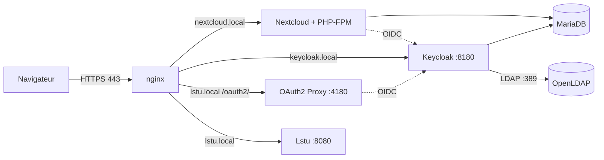

# Tutoriel

**Instructions de montage de l'infrastructure.**

---

Ce tutoriel permet à n'importe qui de reconstruire notre infrastructure à l'identique, de la machine vierge jusqu'à une connexion réussie sur Nextcloud et Lstu avec un compte de l'annuaire.

## 1. Ce que l'on va obtenir

Un unique conteneur Docker se comporte comme un serveur Debian 12 complet (avec `systemd`) et héberge toutes les briques.



| Adresse | Service |
|---|---|
| `https://nextcloud.local` | Nextcloud, connexion via Keycloak |
| `https://keycloak.local` | Keycloak (console d'administration sur `/admin`) |
| `https://lstu.local` | Lstu, pages d'ajout protégées par OAuth2 Proxy |

Seuls les ports 80 et 443 sont exposés. nginx est le point d'entrée unique : tous les autres services écoutent uniquement en local dans le conteneur.

## 2. Prérequis

- Une machine **Linux** (développé sous Arch Linux). Docker Desktop sous Windows ou macOS n'est pas garanti pour `systemd` dans un conteneur.
- Docker et le plugin Docker Compose (`docker compose version` doit répondre).
- `git` et `openssl`.
- Les ports **80 et 443** libres sur la machine.
- Environ 10 Go de disque, 4 Go de RAM, et un accès à Internet pendant la construction (téléchargement de Nextcloud, Keycloak, des dépendances Perl de Lstu, etc.).

## 3. Récupérer le projet

```bash
git clone <URL-DU-DEPOT> crochet-fisson-admin-web
cd crochet-fisson-admin-web
```

## 4. Créer l'autorité de certification et le certificat

Nextcloud exige du HTTPS, et Keycloak, Nextcloud et OAuth2 Proxy se parlent en HTTPS entre eux. Nous créons donc notre propre autorité de certification (CA), comme le suggère le sujet, et un certificat signé par elle.

```bash
bash ansible/certs/gen-certs.sh
```

Le script suit les commandes du sujet (`openssl genrsa`, `openssl req`, `openssl x509 -req`) avec une différence importante : le certificat contient un **SAN** (*Subject Alternative Name*) listant les trois domaines. Les navigateurs récents ignorent le `CN` et exigent le SAN.

Fichiers créés dans `ansible/certs/` :

| Fichier | Rôle |
|---|---|
| `ca.crt`, `ca.key` | Notre autorité de certification. Le script ne la recrée pas si elle existe déjà. |
| `server.crt`, `server.key` | Certificat unique valable pour `nextcloud.local`, `keycloak.local` et `lstu.local`. |

Vérification :

```bash
openssl verify -CAfile ansible/certs/ca.crt ansible/certs/server.crt     # server.crt: OK
openssl x509 -in ansible/certs/server.crt -noout -ext subjectAltName     # les 3 domaines
```

## 5. Préparer la machine hôte

### 5.1 Résolution des noms de domaine

```bash
echo "127.0.0.1 nextcloud.local keycloak.local lstu.local" | sudo tee -a /etc/hosts
```

### 5.2 Faire confiance à la CA

Sans cette étape, le navigateur affichera des alertes de sécurité (le sujet le recommande aussi).

**Arch Linux :**
```bash
sudo trust anchor --store ansible/certs/ca.crt
```

**Debian / Ubuntu :**
```bash
sudo cp ansible/certs/ca.crt /usr/local/share/ca-certificates/
sudo update-ca-certificates
```

**Firefox** utilise son propre magasin : *Paramètres, Vie privée et sécurité, Afficher les certificats, Autorités, Importer*, puis cocher « Confirmer cette AC pour identifier des sites web ».

> Les certificats servent uniquement à ce projet. Les mots de passe du dépôt (voir §9) sont des valeurs de démonstration, à ne pas réutiliser en production.

## 6. Construire et lancer l'infrastructure

```bash
docker compose up -d --build
```

La première construction est longue (compter plusieurs minutes), principalement à cause de la compilation des dépendances Perl de Lstu et du build de Keycloak. Les suivantes sont rapides : le `Dockerfile` crée **une couche par service**, et Docker ne refait que celles dont les fichiers ont changé.

> Si un fichier `docker-compose.override.yml` est présent (il est prévu pour le développement), Docker Compose le charge automatiquement : il monte le dossier `ansible/` dans le conteneur. Pour un lancement « propre » identique à celui d'un nouvel utilisateur, utilise :
> ```bash
> docker compose -f docker-compose.yml up -d --build
> ```

### Ce qui se passe pendant la construction

| Couche | Playbook | Ce qu'il fait |
|---|---|---|
| 1 | `01-ldap.yml` | Installe `slapd`, crée l'annuaire et importe les utilisateurs de test (mots de passe hachés avec `slappasswd`) |
| 2 | `02-nginx.yml` | Installe nginx, dépose les certificats, installe la CA dans le conteneur |
| 3 | `03-mariadb.yml` | Installe MariaDB, crée les bases et utilisateurs de Nextcloud et Keycloak |
| 4 | `04-nextcloud.yml` | Installe PHP-FPM, télécharge l'archive officielle (vérifiée par sha256), installe Nextcloud, importe la CA, installe l'app `user_oidc` |
| 5 | `05-keycloak.yml` | Installe Java, l'archive officielle de Keycloak, génère la configuration et le realm, lance `kc.sh build` |
| 6 | `06-lstu.yml` | Clone Lstu depuis le dépôt officiel, installe ses dépendances avec `carton`, crée le vhost |
| 7 | `07-oauth2-proxy.yml` | Installe la release officielle d'OAuth2 Proxy et le vhost protégé de Lstu |
| 8 | `08-provision.yml` | Installe l'unité systemd qui terminera la configuration au premier démarrage |

Pendant le build, aucun service ne tourne (un script `policy-rc.d` les en empêche). Quand un outil a besoin d'une base de données en marche, le playbook démarre MariaDB temporairement puis l'arrête (voir `ansible/tasks/`).

### Ce qui se passe au premier démarrage

Certaines étapes exigent que les services tournent. Une unité `provision.service` s'exécute une seule fois : elle attend que Keycloak ait importé le realm, puis déclare Keycloak comme fournisseur d'identité dans Nextcloud (`occ user_oidc:provider`).

Pour suivre le démarrage :

```bash
docker exec -it debian-admin-web-prj journalctl -f -u keycloak -u provision -u oauth2-proxy
```

Keycloak met une à deux minutes à être prêt. Pendant ce temps, des erreurs `502` ou `Connection refused` dans les journaux de nginx et d'OAuth2 Proxy sont **normales** : OAuth2 Proxy réessaie toutes les 5 secondes jusqu'à ce que Keycloak réponde. On considère le démarrage terminé quand :

```bash
docker exec debian-admin-web-prj systemctl is-active provision oauth2-proxy keycloak
# active, active, active
```

## 7. Vérifier chaque brique à la main

Les comptes de test sont `jdoe` et `asmith`, mot de passe `password`.

### OpenLDAP

```bash
docker exec debian-admin-web-prj ldapsearch -x -LLL -H ldap://localhost \
  -D "cn=admin,dc=iutnc-crochet-fisson,dc=local" -w "ldap-admin-pw" \
  -b "ou=users,dc=iutnc-crochet-fisson,dc=local" uid mail
```
Doit lister `jdoe` et `asmith` avec leur adresse mail.

### Keycloak

1. Ouvrir `https://keycloak.local/admin` et se connecter avec `admin` / `kc-admin-pw`.
2. Choisir le realm **sae** (menu en haut à gauche).
3. *User federation* : le fournisseur `openldap` doit apparaître.
4. *Users* : chercher `jdoe`. Keycloak l'importe depuis l'annuaire à la première recherche.
5. *Clients* : `nextcloud` et `lstu` existent.

### Nextcloud

1. Ouvrir `https://nextcloud.local`.
2. Cliquer sur le bouton de connexion Keycloak (*Log in with keycloak*).
3. Saisir `jdoe` / `password` sur la page de Keycloak : on arrive dans Nextcloud, connecté en tant que `jdoe`.

Le compte administrateur local reste disponible : `admin` / `nc-admin-pw`.

### Lstu et OAuth2 Proxy

1. Ouvrir `https://lstu.local` : le navigateur est redirigé vers Keycloak (c'est OAuth2 Proxy qui l'a exigé).
2. Se connecter avec `jdoe` / `password` : le formulaire de Lstu s'affiche.
3. Raccourcir une URL et copier le lien obtenu.
4. Ouvrir ce lien court dans une **fenêtre de navigation privée** : la redirection fonctionne **sans** connexion, c'est la contrainte du sujet.
5. Dans cette même fenêtre privée, ouvrir `https://lstu.local` : la connexion est exigée.

## 8. Tests automatiques

```bash
bash tests/run-tests.sh
```

Le script exécute une série de `curl` et de commandes dans le conteneur, compare chaque résultat à ce qui est attendu (services actifs, annuaire, HTTPS, Keycloak, parcours de connexion complets sur Nextcloud et Lstu, pages protégées, liens courts publics, origine des installations) et écrit le rapport dans [`documents/tests.md`](tests.md) avec un verdict par test. Il rejoue une vraie connexion : formulaire Keycloak, envoi du mot de passe, suivi des redirections. Le code de sortie vaut 0 si tout passe.

## 9. Personnaliser

Tout se règle dans `ansible/group_vars/all.yml` :

| Variable | Rôle |
|---|---|
| `ldap_domain`, `ldap_base_dn` | Domaine de l'annuaire |
| `ldap_users` | Utilisateurs créés (identifiant, nom, mail, mot de passe) |
| `*_password`, `*_client_secret`, `lstu_secret` | Mots de passe et secrets |
| `keycloak_version`, `oauth2_proxy_version`, `lstu_version` | Versions installées |
| `keycloak_realm` | Nom du realm Keycloak |

Après modification, relancer `docker compose up -d --build`.

> Pour aller plus loin : les mots de passe sont en clair dans ce fichier, ce qui convient à une démonstration. Pour un vrai usage, les chiffrer avec `ansible-vault`.

## 10. Comprendre les points délicats

**Pourquoi un seul certificat pour trois domaines ?** Le SAN permet de faire signer un seul certificat valable pour `nextcloud.local`, `keycloak.local` et `lstu.local`. Chaque vhost nginx le réutilise.

**Pourquoi la CA est-elle installée à trois endroits ?** Sur la machine hôte (pour le navigateur), dans le conteneur (pour OAuth2 Proxy et les outils en ligne de commande) et dans Nextcloud lui-même (`occ security:certificates:import`). Nextcloud utilise en effet son propre magasin de CA, pas celui du système, et ne pourrait pas contacter Keycloak sans cela.

**Pourquoi `extra_hosts` dans `docker-compose.yml` ?** Nextcloud et OAuth2 Proxy contactent `https://keycloak.local`. Dans le conteneur, ce nom doit pointer vers lui-même (`127.0.0.1`) pour atteindre nginx.

**Comment Keycloak est-il configuré sans clic ?** Le realm `sae`, ses deux clients (`nextcloud`, `lstu`) et la fédération LDAP sont décrits dans `ansible/templates/realm.json.j2`, importé au démarrage avec `--import-realm`. La configuration est donc versionnée et reproductible. Les attributs LDAP (`uid`, `givenName`, `sn`, `mail`) sont associés aux champs Keycloak par des *mappers*.

**Comment Lstu est-il protégé ?** nginx interroge OAuth2 Proxy (`auth_request`) avant de transmettre la requête à Lstu. Dans `ansible/conf/nginx/lstu.conf`, trois zones coexistent :

| Zone | Règle | Accès |
|---|---|---|
| `/oauth2/` | Redirigée vers OAuth2 Proxy | Public (c'est le mécanisme de connexion) |
| URL courtes (`^/[A-Za-z0-9_-]{8}$`) | Transmise directement à Lstu | **Public** |
| Tout le reste (formulaire, `/a`, `/stats`...) | `auth_request` obligatoire | **Authentifié** |

Le défaut est donc la protection : un chemin inconnu est refusé, et seules les URL courtes sont publiques. La regex suppose que les codes générés par Lstu font 8 caractères (sa longueur par défaut).

**Pourquoi des tampons nginx agrandis sur `/oauth2/` ?** Après connexion, OAuth2 Proxy renvoie un cookie de session volumineux (les jetons de Keycloak). Avec les tampons par défaut, nginx refuse la réponse (`upstream sent too big header`) et la connexion échoue. Les directives `proxy_buffer_size`, `proxy_buffers` et `large_client_header_buffers` règlent le problème.

## 11. Développer sans tout reconstruire

Avec `docker-compose.override.yml`, le dossier `ansible/` de la machine hôte est monté dans le conteneur. On modifie un fichier, puis on rejoue le playbook concerné dans le conteneur qui tourne :

```bash
docker exec debian-admin-web-prj ansible-playbook /ansible/07-oauth2-proxy.yml
docker exec debian-admin-web-prj systemctl restart oauth2-proxy
```

Pour un simple changement de configuration nginx :

```bash
docker exec debian-admin-web-prj bash -c '
  cp /ansible/conf/nginx/lstu.conf /etc/nginx/sites-available/lstu.conf &&
  nginx -t && systemctl reload nginx'
```

Cette méthode convient aux playbooks 05, 06 et 07. Pour 01, 03 et 04 (annuaire, base de données, Nextcloud), reconstruire l'image : l'import LDAP se fait hors-ligne et ne peut pas être rejoué sur un `slapd` en marche. Une fois le résultat satisfaisant, la modification est figée par `docker compose up -d --build`.

## 12. Dépannage

| Symptôme | Cause probable | Solution |
|---|---|---|
| `502 Bad Gateway` juste après le lancement | Keycloak n'a pas fini de démarrer | Attendre une à deux minutes, suivre `journalctl -u keycloak` |
| Alerte de certificat dans le navigateur | CA non installée côté navigateur | Reprendre le §5.2, Firefox a son propre magasin |
| Page `500 Internal Server Error` d'OAuth2 Proxy après la connexion | Cookie trop gros pour les tampons nginx | Vérifier les directives `proxy_buffer*` dans `lstu.conf`, consulter `/var/log/nginx/error.log` |
| `invalid_grant "Code not valid"` dans OAuth2 Proxy | Un code d'autorisation OAuth ne sert qu'une fois, la page de callback a été rejouée | Repartir de `https://lstu.local` en navigation privée, ne pas recharger la page de callback |
| Pas de bouton Keycloak dans Nextcloud | Le provisioning n'a pas abouti | `docker exec debian-admin-web-prj journalctl -u provision`, puis `systemctl restart provision` après avoir supprimé `/var/lib/provisioned` |
| Un lien court demande l'authentification | La longueur des codes de Lstu n'est pas 8 | Adapter la regex `{8}` dans `ansible/conf/nginx/lstu.conf` |

Commandes utiles :

```bash
docker exec debian-admin-web-prj systemctl --failed          # services en échec
docker exec debian-admin-web-prj journalctl -u <service> -n 80 --no-pager
docker exec debian-admin-web-prj tail -n 50 /var/log/nginx/error.log
```

## 13. Arrêter et repartir de zéro

```bash
docker compose down                 # arrête et supprime le conteneur
docker compose build --no-cache     # reconstruit entièrement l'image
docker compose up -d
```

Sans volume déclaré dans `docker-compose.yml`, l'état (annuaire, bases, fichiers de Nextcloud) est reconstruit depuis l'image à chaque nouvelle création du conteneur. Un simple `docker compose stop` puis `start` conserve les données.